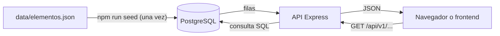

# API Tabla Periódica IUPAC

API REST con los **118 elementos** de la Tabla Periódica, con datos en español.
Stack: **Node.js · Express · PostgreSQL**. Desplegada en **Vercel**, con la base de datos en **Neon**.

## Probar la API

Dirección base: **https://tabla-periodica-api.vercel.app**

- [Descripción de la API](https://tabla-periodica-api.vercel.app/)
- [Hierro (número atómico 26)](https://tabla-periodica-api.vercel.app/api/v1/elementos/26)
- [Gases nobles (grupo 18)](https://tabla-periodica-api.vercel.app/api/v1/elementos?grupo=18)
- [Elementos del período 3](https://tabla-periodica-api.vercel.app/api/v1/periodos/3)
- [Categorías](https://tabla-periodica-api.vercel.app/api/v1/categorias)

## ¿Cómo funciona?



1. `data/elementos.json` es solo la **fuente de los datos**. La API **no lo lee** al responder.
2. `npm run seed` copia esos datos a la tabla `elementos` de PostgreSQL. Se hace una vez, o cada vez que cambie el JSON.
3. Cada petición a la API ejecuta una consulta SQL contra PostgreSQL y devuelve el resultado en JSON.

| Pieza | Qué es | Dónde vive |
|---|---|---|
| Código (este repositorio) | Proyecto Express | GitHub |
| API en línea | El código ejecutándose | Vercel |
| Base de datos | Tabla `elementos` con los 118 registros | Neon (PostgreSQL) |

## Estructura

```
tabla-periodica-api/
├── data/elementos.json     ← datos originales (118 elementos)
├── db/schema.sql           ← define la tabla "elementos"
├── scripts/seed.js         ← carga el JSON en PostgreSQL
├── src/
│   ├── index.js            ← punto de entrada (app Express)
│   ├── db.js               ← conexión a PostgreSQL
│   ├── routes/             ← un archivo por grupo de endpoints
│   └── utils/              ← validaciones y formato de respuesta
├── .env.example            ← plantilla de variables de entorno
└── package.json
```

## Endpoints

| Método | Ruta | Qué devuelve |
|---|---|---|
| GET | `/` | Descripción de la API |
| GET | `/api/v1/salud` | Comprueba que la API y la base de datos responden |
| GET | `/api/v1/elementos` | Todos los elementos (con filtros) |
| GET | `/api/v1/elementos/:numero` | Un elemento por número atómico (1–118) |
| GET | `/api/v1/elementos/simbolo/:simbolo` | Un elemento por símbolo (`Fe` o `fe`) |
| GET | `/api/v1/grupos/:n` | Elementos de un grupo (1–18) |
| GET | `/api/v1/periodos/:n` | Elementos de un período (1–7) |
| GET | `/api/v1/categorias` | Categorías y cuántos elementos tiene cada una |

Filtros de `/api/v1/elementos` (se pueden combinar):
`?categoria=Gas noble` · `?tipo=Metal` · `?bloque=p` · `?estado=gas` · `?grupo=18` · `?periodo=3` · `?buscar=hidr`

Ejemplo: `/api/v1/elementos?periodo=2&bloque=p&estado=gas`

Errores siempre en JSON: `400` (parámetro inválido), `404` (no existe), `500` (error interno).

### Ejemplo de respuesta (`/api/v1/elementos/26`, campos principales)

```json
{
  "numero_atomico": 26,
  "simbolo": "Fe",
  "nombre": "Hierro",
  "masa_atomica": 55.845,
  "grupo": 8,
  "periodo": 4,
  "bloque": "d",
  "tipo": "Metal",
  "categoria": "Metal de transición",
  "configuracion_electronica": "[Ar] 3d6 4s2",
  "punto_fusion_c": 1538.0,
  "punto_ebullicion_c": 2861.0,
  "densidad_g_cm3": 7.87,
  "estado_normal": "sólido",
  "posicion_tabla": {
    "fila": 4,
    "columna": 8
  }
}
```

## Unidades de medida

| Campo | Unidad |
|---|---|
| `masa_atomica` | u (unidad de masa atómica) |
| `radio_atomico_pm` | pm (picómetros) |
| `punto_fusion_c`, `punto_ebullicion_c` | °C |
| `densidad_g_cm3` | g/cm³ |
| `electronegatividad_pauling` | sin unidad (escala de Pauling) |

`null` significa dato desconocido o no medido.

## Uso en local

Requisitos: Node.js 20 o superior y una base PostgreSQL (por ejemplo, con Docker).

1. Levanta PostgreSQL con Docker (si el puerto 5432 está ocupado, cambia el primer número de `-p`):
   ```bash
   docker run --name pg-tabla -e POSTGRES_PASSWORD=postgres -e POSTGRES_DB=tabla_periodica -p 5432:5432 -d postgres:16
   ```
2. Instala dependencias:
   ```bash
   npm install
   ```
3. Crea tu archivo de variables a partir de la plantilla y ajusta `DATABASE_URL`:
   ```bash
   cp .env.example .env
   ```
4. Carga los datos (crea la tabla y los 118 elementos):
   ```bash
   npm run seed
   ```
5. Levanta la API:
   ```bash
   npm run dev
   ```
6. Prueba `http://localhost:3000/api/v1/elementos/26`.

## Despliegue

1. El código se sube a GitHub.
2. En Vercel se importa el repositorio (detecta Express con `src/index.js`).
3. La base de datos PostgreSQL se crea en Neon y su cadena de conexión se guarda como variable de entorno `DATABASE_URL` en la configuración del proyecto de Vercel.
4. El seed se ejecuta una vez, apuntando a esa base.

## Seguridad

- Las credenciales **nunca** se suben al repositorio: `.env` está en `.gitignore`.
- `.env.example` solo contiene valores de ejemplo.
- Las consultas SQL usan parámetros (`$1`, `$2`), lo que evita la inyección SQL.
